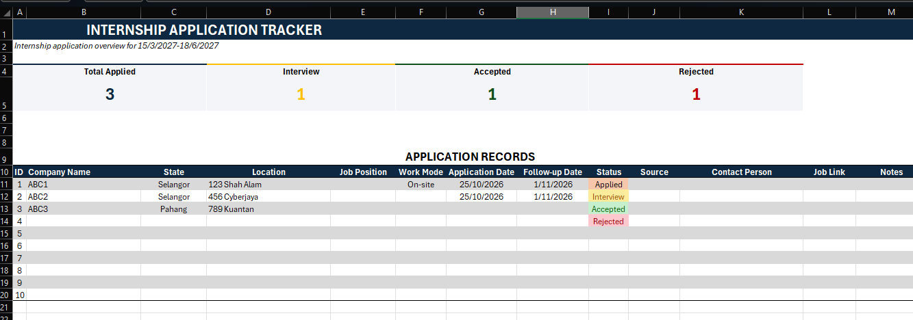

# Internship Application Tracker

A simple, clean Excel template to keep track of your internship applications in one place. No macros, no setup. Just open it and start typing.

## Features

- **Live summary cards** showing Total Applied, Interview, Accepted and Rejected counts
- **Status dropdown** (Applied, Interview, Accepted, Rejected) with automatic colour coding
- **Auto follow-up date** set 7 days after you apply, so you know when to follow up
- **Dropdowns** for Work Mode (On-site, Hybrid, Remote) and Malaysian states
- **Table format**: new rows keep the formatting, dropdowns and formulas automatically

## Getting Started

1. Download `INTERNSHIP_APPLICATION_TRACKER.xlsx` from this repository.
2. Open it in Microsoft Excel (desktop or Excel for the web).
3. Delete the sample rows (see [Clear the sample data](#clear-the-sample-data)).
4. Add your own applications.

## How to Use

### Add an application

Fill in one row per application. Only the first few columns are essential; the rest are optional.

| Column | What to enter |
|---|---|
| **ID** | Running number (1, 2, 3...) |
| **Company Name** | Name of the company (counted in *Total Applied*) |
| **State** | Pick from the dropdown |
| **Location** | City or area |
| **Job Position** | Role you applied for |
| **Work Mode** | On-site, Hybrid or Remote (dropdown) |
| **Application Date** | Date you applied |
| **Follow-up Date** | Filled in automatically (Application Date + 7 days). Do not type here |
| **Status** | Applied, Interview, Accepted or Rejected (dropdown) |
| **Source** | Where you found it (LinkedIn, JobStreet, career fair, etc.) |
| **Contact Person** | HR or recruiter name |
| **Job Link** | Link to the job posting |
| **Notes** | Anything else (interview date, documents needed, etc.) |

### Update your status

When you hear back, change the **Status** cell. The colour and the summary cards at the top update automatically.

### Add more rows

Click the last cell of the table and press **Tab**, or type directly in the row under the table. The table expands by itself and keeps the dropdowns, colours and formulas.

### Clear the sample data

The file comes with a few sample rows (ABC1 to ABC3). To start fresh:

1. Select the cells in the **Company Name** to **Application Date** columns and press **Delete**.
2. Do the same for the **Status** to **Notes** columns.
3. Leave the **Follow-up Date** column alone, because it holds the formula.

Delete the *contents* of the cells only. Do not delete the table rows or columns, or the summary cards may stop working.

### Customise

- **Change the follow-up gap:** click a cell in the Follow-up Date column and change `+7` in the formula to the number of days you prefer.
- **Change the internship period:** edit the subtitle under the title.
- **Change the status names:** go to *Data > Data Validation* on the Status column. If you rename a status, update the summary formulas too.

## Requirements

- Microsoft Excel 2016 or later, or Excel for the web.
- Google Sheets has not been tested, and the summary formulas may not work there.

## Privacy Tip

If you share your own copy publicly, remove real company names and contact details first.

## License

Free to use and modify for personal use.

---

Made by Noraiman. Feedback and suggestions are welcome!
